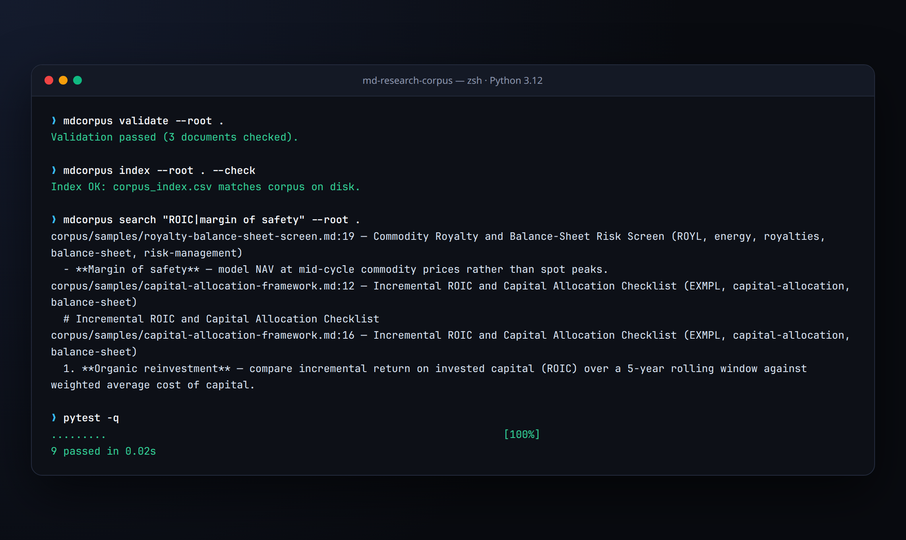
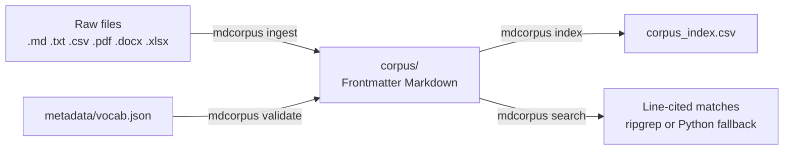

# md-research-corpus

A lightweight, version-controlled Markdown research corpus toolkit with controlled metadata validation, CSV inventory auditing, and cited search.

Built to keep raw files (PDFs, Word docs, spreadsheets) out of Git while versioning clean, normalized Markdown with YAML frontmatter, structured vocabularies, and fast `ripgrep`-backed retrieval.



## Architecture



## Features

- **Zero mandatory runtime dependencies** — core parsing, indexing, validation, and search use the Python 3.11+ standard library; optional `[parsers]` extra enables PDF/DOCX/XLSX conversion.
- **Controlled vocabularies** — enforce valid `doc_type`, `status`, `themes`, ISO dates, and unique IDs across every note via `metadata/vocab.json`.
- **Index drift detection** — `mdcorpus index --check` exits nonzero in CI if `corpus_index.csv` falls out of sync with files on disk (missing files, removed documents, or rows whose metadata, size, or line count changed).
- **Cited, metadata-filtered search** — filter by `--ticker`, `--theme`, or `--doc-type`, automatically using `ripgrep` when installed and falling back to Python regex otherwise, with `--json` output for LLM/agent pipelines.

## Quickstart

```bash
python3 -m venv .venv
source .venv/bin/activate
pip install -e ".[dev]"

# Optional: enable PDF, DOCX, and XLSX ingestion
pip install -e ".[parsers]"
```

Run against the included sample corpus:

```bash
# Validate all frontmatter against metadata/vocab.json
mdcorpus validate --root .

# Build (or verify) corpus_index.csv
mdcorpus index --root .
mdcorpus index --root . --check

# Search with line-level citations and metadata filters
mdcorpus search "ROIC|reinvestment" --theme capital-allocation
mdcorpus search "margin of safety" --json
```

Ingest a new raw file:

```bash
mdcorpus ingest path/to/notes.txt \
  --dest corpus/notes \
  --title "Q3 Capital Allocation Note" \
  --doc-type memo \
  --tickers ACME \
  --themes capital-allocation,balance-sheet
```

## Development & checks

```bash
ruff check src tests
pytest -v
```

## License

MIT
